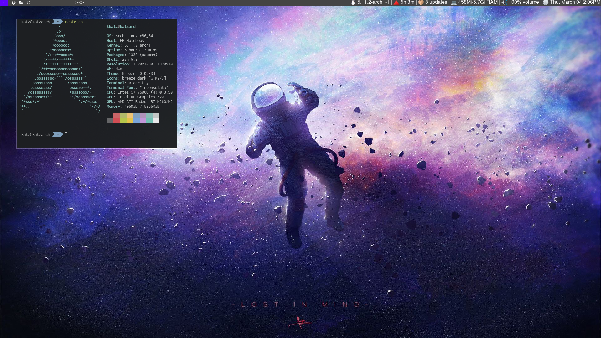

# dwm - dynamic window manager

dwm is an extremely fast, small, and dynamic window manager for X.

# Yet another config

List of [patches](https://dwm.suckless.org/patches/):
- autostart
- dwmblocks
- centermaster
- bottomstack
- alternativetags
- gridmode
- hide-vacant-tags
- pertag
- status2d
- statuscmd (status2d variant, signals dwmblocks)

## Dependencies
- ttf-hack-nerd (bar, dmenu and status icons)
- [dwmblocks](https://github.com/thodkatz/dwmblocks) with the statuscmd patch, on PATH
